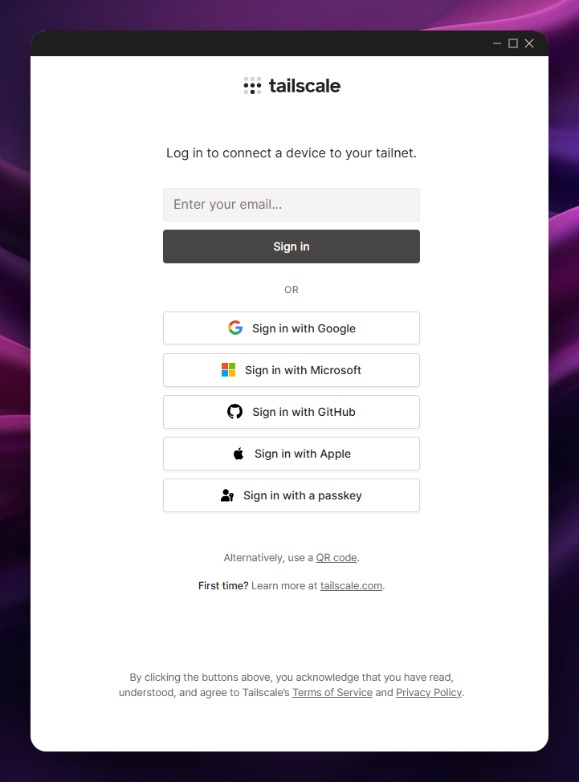
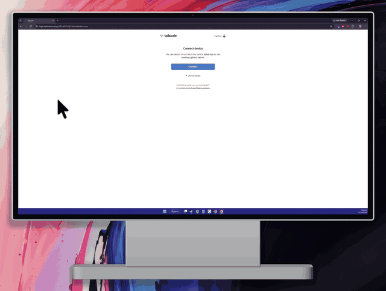
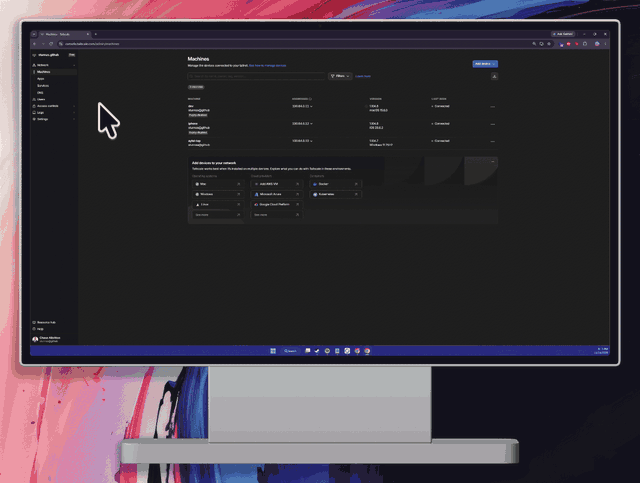
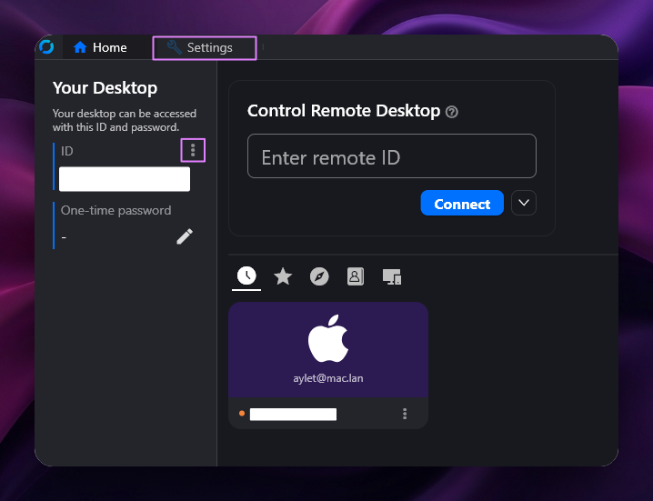
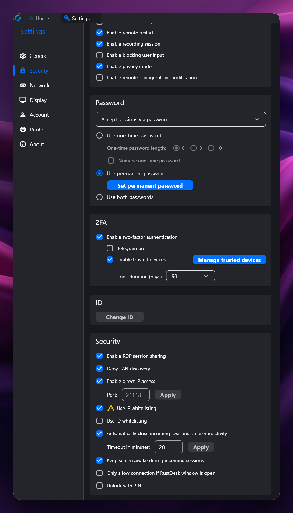
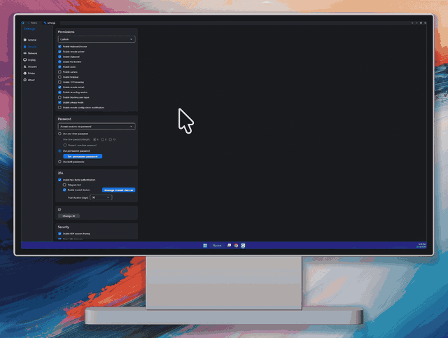
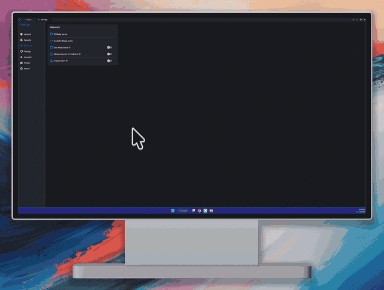

# Set up a Windows host

[Back to the README](../README.md) · [Glossary](glossary.md)

> **Do this on the HOST**: the Windows PC that will be controlled (for example the desktop you leave at home).
> The device you'll sit at is the controller; it has its own guide: [Windows](controller-windows.md),
> [Mac](controller-mac.md) or [iPhone](controller-iphone.md).

When you're done, this PC can be reached by RustDesk from your controllers, only through Tailscale, only with a
password and a two-factor code, and from nowhere else.

**Example addresses in these guides:** the host is `100.64.0.10` (home address `192.168.0.10`) and the controller
is `100.64.0.11`. Yours will be different: always use the real ones from your Tailscale admin console.

## Contents

1. [Before you start](#before-you-start)
2. [The order across both devices](#the-order-across-both-devices)
3. [Manual path](#manual-path)
4. [Script path](#script-path)
5. [Check the host](#check-the-host)
6. [When something goes wrong](#when-something-goes-wrong)

## Before you start

- **Admin rights on this PC.** Installing programs and changing firewall rules need them.
- **An account to sign in to Tailscale** (Google, Microsoft or GitHub). Turn on two-factor for that account first:
  whoever can sign in to it can add devices to your private network.
- **An authenticator app on your phone**, such as Microsoft Authenticator or Google Authenticator.
- **A password manager** (Bitwarden, 1Password, or the one built into your browser) to make and store a long
  random password.
- About 45 minutes.

## The order across both devices

The host's whitelist needs the controller's Tailscale address, and the controller only gets one after it joins
Tailscale. So:

1. **Host:** this guide, steps 1 and 2 of the manual path (or the script's first run).
2. **Controller:** its guide, step 1 ([Windows](controller-windows.md#1-join-tailscale), [Mac](controller-mac.md#1-join-tailscale)
   or [iPhone](controller-iphone.md#1-join-tailscale)). Note its `100.x` address.
3. **Host:** finish this guide with the controller's address in the whitelist.
4. **Controller:** [connect](controller-windows.md#3-connect) and [run the tests](controller-windows.md#test-from-the-controller).

## Manual path

### 1. Tailscale

1. Download Tailscale from [tailscale.com/download](https://tailscale.com/download) and install it.
2. Click the Tailscale icon by the clock (click `^` if you don't see it), choose **Log in**, and sign in. Use the
   **same account** on every device: two accounts make two separate networks that can't see each other.

   

   A browser page opens. Sign in with the account you chose, then click **Connect** to add this PC.

   

   
3. **Turn off key expiry.** In the [admin console](https://login.tailscale.com/admin/machines), click the `...` menu
   next to this PC and choose **Disable key expiry**. Otherwise Tailscale makes the PC sign in again every 180
   days, and a host nobody sits at can't.

   
4. Note this PC's address starting with `100.` (the short one, not the long `fd7a:` one; see the [glossary](glossary.md)) from the admin console: the controller connects to it.

### 2. RustDesk

1. Download it **only** from [github.com/rustdesk/rustdesk/releases](https://github.com/rustdesk/rustdesk/releases).
   Pick the release with the pinned version: open [`tailnet-desk.psm1`](../scripts/windows/tailnet-desk.psm1) and read the line
   `RustDeskVersion = '...'` near the top. Then open that
   release's **Assets** and pick the file ending in `x86_64.exe`. Fake RustDesk sites hand out malware, so don't use a search ad.
2. Before running it, check it's RustDesk's own: right-click the file → **Properties** → **Digital Signatures**. The
   list must show **PURSLANE** (the company behind RustDesk, the same name as `RustDeskSigner` in the script); select
   it, click **Details**, and check it says "This digital signature is OK". No **Digital Signatures** tab, another
   name or another message means it isn't RustDesk's own, so delete it.
3. Run it and choose **Install** (not "Run without install"). Installing adds the RustDesk **service**, which
   lets you reach the PC even at the Windows sign-in screen.

### 3. Firewall: let RustDesk answer only through Tailscale

RustDesk's installer adds Windows Firewall rules that accept connections on every network adapter. These commands
limit them to Tailscale, so a device on your home network (a guest's phone, a hacked smart TV) can't reach
RustDesk at all. It's a second lock next to the whitelist: the firewall stops connections before RustDesk sees
them. Do this before turning on direct IP access in step 4, so RustDesk is never reachable from every network.

**Open PowerShell as administrator:** press the Windows key, type `powershell`, right-click **Windows PowerShell**
and choose **Run as administrator**, then click **Yes**. The window title starts with "Administrator".


Paste each command as one line and press **Enter**. Common mistakes:

- **A missing hyphen** when copying, e.g. `SelectObject` instead of `Select-Object`. PowerShell then says the term
  "is not recognized".
- **A `>>` prompt** means PowerShell is waiting for the rest of a command. Press **Ctrl+C** and paste again.

1. Find the Tailscale adapter's name. It's almost always `Tailscale` ("Tailscale Tunnel"):

```powershell
Get-NetAdapter | Select-Object Name, InterfaceDescription
```

2. See RustDesk's firewall rules. Their names vary: some PCs have `RustDesk Service` and `rustdesk.exe` rules,
   others only `RustDesk Service`. A red "No MSFT_NetFirewallRule objects found" error for a missing name is
   harmless; the rules that exist are still listed.

```powershell
Get-NetFirewallRule -DisplayName "RustDesk Service","rustdesk.exe" | Select-Object DisplayName, Direction, Action, EdgeTraversalPolicy
```

3. Only if a rule shows `DeferToUser` in the last column: switch it to `Block`. Windows won't limit such a rule to
   one adapter. Skip this if every rule shows `Block`.

```powershell
Get-NetFirewallRule -DisplayName "RustDesk Service","rustdesk.exe" | Where-Object EdgeTraversalPolicy -eq "DeferToUser" | Set-NetFirewallRule -EdgeTraversalPolicy Block
```

4. Limit the rules that **Allow** RustDesk to Tailscale. It prints nothing when it works.

```powershell
Get-NetFirewallRule -DisplayName "RustDesk Service","rustdesk.exe" | Where-Object Action -eq "Allow" | Set-NetFirewallRule -InterfaceAlias "Tailscale"
```

5. Check: every Allow rule should show `InterfaceAlias : Tailscale`.

```powershell
Get-NetFirewallRule -DisplayName "RustDesk Service","rustdesk.exe" | Where-Object Action -eq "Allow" | Get-NetFirewallInterfaceFilter
```

6. Make sure the firewall itself is on and blocks connections nobody asked for. This reads what Windows actually
   applies, including any company or Group Policy settings: Domain, Private and Public should all show `Enabled` as
   `True` and `DefaultInboundAction` as `Block`.

```powershell
Get-NetFirewallProfile -PolicyStore ActiveStore | Select-Object Name, Enabled, DefaultInboundAction
```

### 4. RustDesk security settings

Open RustDesk, click the menu next to your ID (or the gear icon) to open **Settings**, go to **Security**, and click
**Unlock security settings** (approve the admin prompt). Menu names may differ slightly between versions.



The unlocked Security page, set up as the table below says (the whitelist itself is in the next picture):



| Where | Setting | Set it to | Why |
|---|---|---|---|
| Security | Password | **Use permanent password**, then **Set permanent password** | Generate a random password of 20 or more characters in your password manager, save it there, and paste it in. Never reuse it, not even on another of your computers: one leak would then open both. It lets you connect when nobody is at the host. |
| Security | Two-factor authentication | **On** | A QR code appears. In your authenticator app, tap **+**, scan it, and name the entry after this PC. A stolen password alone is then useless. Don't photograph or share the QR code: it's the secret that makes the codes. |
| Security | Enable trusted devices | Your choice | With it on, a controller can tick "trust this device" when it connects, and then skips the 6-digit code for the trust duration (90 days unless you change it). That's convenient on a controller that stays locked, but whoever unlocks it then needs only the password. With it off, every connection asks for the code. Remove a trusted controller under **Manage trusted devices**. |
| Security | Accept sessions | **via password** | A session starts on the password and code alone. Nobody has to be at the host to click Accept. |
| Security | Deny LAN discovery | **On** (ticked) | The PC stops announcing itself to other RustDesk apps on your home network. |
| Security | Enable direct IP access | **On**, port **21118** | The controller connects straight to the host's Tailscale address, not through RustDesk's public servers. |
| Security | Use IP whitelisting | **On**, add only the controller's `100.x` address | RustDesk refuses everything else with "Your ip is blocked by the peer". Never add this PC's own address, and never a whole range like `100.64.0.0/10`: that lets in every device on your Tailscale network. |
| Network | ID server and Relay server | `127.0.0.1` in both | Stops the PC registering with RustDesk's public servers, which would be a second way in outside Tailscale. RustDesk will then say it can't reach a server; that's expected. |

Adding the controller to the whitelist (the example address `100.64.0.11`; use your controller's):



Setting the ID and relay servers on the Network page:



### 5. Never sleep while plugged in

Windows **Settings → System → Power** ("Power & battery" on Windows 11): set **Sleep** to **Never** when plugged
in. A sleeping PC can't be reached. The screen turning off is fine.

Then [check the host](#check-the-host) and go to the controller to [connect](controller-windows.md#3-connect).

## Script path

> **Tested on one real PC that already had Tailscale and RustDesk.** On it, the script and the check passed, and
> the tests from the controller worked. Installing Tailscale and RustDesk with the script, and the publisher
> signature checks added since, haven't been run on a real PC yet: on a new PC, you can install them by hand
> ([steps 1](#1-tailscale) and [2](#2-rustdesk)) and then run the script. See the [README's Status](../README.md#status).

The script does the manual path's steps except the ones that need you: signing in to Tailscale, turning off key
expiry, choosing the password and scanning the two-factor QR code. It's safe to run more than once: each run skips
what's already done and keeps the controllers already on the whitelist.

The scripts run as administrator, so they trust your Windows account and every program running as you: such a
program could change the scripts in your Downloads folder before you run them. Only run them on a PC you trust,
from a ZIP you just downloaded from this repo.

### 1. Get the scripts

1. Open [the repo's main page](https://github.com/stunnas/tailnet-desk), click the green **Code** button, then
   **Download ZIP**.
2. Open your Downloads folder, right-click the ZIP and choose **Extract All**, then **Extract**.
3. Open the extracted `tailnet-desk-main` folder (open it twice if there's a folder with the same name inside),
   then `scripts`, then `windows`. Keep this window open.

### 2. Open PowerShell as administrator in that folder

1. Open PowerShell as administrator ([how](#3-firewall-let-rustdesk-answer-only-through-tailscale)).
2. Type `cd ` (with a space), drag the `windows` folder (the one inside `scripts`, from step 1.3) from File Explorer
   into the PowerShell window, and press **Enter**. The prompt now ends in `\scripts\windows>`. If it ends in
   anything else, such as `\tailnet-desk-main>` or `\scripts>`, you dragged another folder: type `cd ` again and
   drag in the `windows` folder from step 1.3.
3. Windows blocks scripts downloaded from the internet by default. Allow these ones for this window only. Run
   the two commands one at a time. The first asks "Do you want to change the execution policy?": type `Y` and
   press **Enter**.

```powershell
Set-ExecutionPolicy -Scope Process -ExecutionPolicy Bypass
```

```powershell
Get-ChildItem *.ps1, *.psm1 | Unblock-File
```

The first command only lasts until you close this window. The second removes the "downloaded from the internet"
mark from these files, so Windows stops asking about them.

### 3. First run

```powershell
.\install-host.ps1
```

What happens:

1. **Tailscale** (the pinned version), if it isn't installed yet, is downloaded from Tailscale's own package server
   into a new folder only administrators can change. The script checks the installer's SHA-256 fingerprint against
   the one stored in the script and that it carries Tailscale's valid signature (`Tailscale Inc.`), installs it, and
   checks the installed `tailscale.exe` the same way. An existing Tailscale is kept once its `tailscale.exe` passes
   that check. The first time, the script stops and asks you to sign in: click the Tailscale icon by the clock (or
   open Tailscale from the Start menu), choose **Log in**, and sign in. Then run the same command again.
2. **RustDesk** (the pinned version), if it isn't installed yet, is downloaded from its official GitHub page into a
   new folder only administrators can change. The script checks the file's SHA-256 fingerprint against the one
   stored in the script and that it carries RustDesk's valid signature (`PURSLANE`, the company behind RustDesk),
   keeps the file locked until the installer finishes, and refuses to run a file that fails either check. An
   existing RustDesk is kept, whatever its version, once its `rustdesk.exe` passes the signature check. Either way, RustDesk then stops using its
   public ID and relay servers.
3. **The firewall:** RustDesk's Allow rules are limited to the Tailscale adapter.
4. **RustDesk's settings:** the same as the manual table, except the password, two-factor and trusted devices (left
   as you set them). Direct IP access
   stays **off** for now, because there's no controller to whitelist yet.
5. **Sleep:** the PC no longer sleeps while plugged in.
6. **A check** runs and prints PASS or FAIL lines, then the steps left for you.

At the end it prints **this PC's Tailscale address**: the controller connects to it. Then do the manual path's
[key expiry step](#1-tailscale) (step 3) and the password and two-factor rows of [step 4](#4-rustdesk-security-settings).

### 4. Second run, with the controller's address

Once the controller has [joined Tailscale](controller-windows.md#1-join-tailscale), find the **controller's**
`100.x` address in the [Tailscale admin console](https://login.tailscale.com/admin/machines). Not this PC's own
address. Then, in the same admin PowerShell window, run the script with it in place of the example:

```powershell
.\install-host.ps1 -ControllerIp 100.64.0.11
```

This turns on direct IP access with only that address on RustDesk's whitelist. For more than one controller,
separate the addresses with commas: `-ControllerIp 100.64.0.11,100.64.0.12`.

On a PC that already has Tailscale and RustDesk, the output looks like this (with your addresses):

```text
== Step 1 of 6: Tailscale
Tailscale is already installed.
Tailscale is signed in. This PC's (the host's) Tailscale address: 100.64.0.10

== Step 2 of 6: RustDesk
RustDesk is already installed.
RustDesk no longer uses its public servers.

== Step 3 of 6: Windows Firewall
RustDesk's firewall rules now apply to the Tailscale adapter only.

== Step 4 of 6: RustDesk security settings
Direct IP access: on. Whitelist (from -ControllerIp): 100.64.0.11

== Step 5 of 6: Sleep
This PC no longer sleeps while plugged in. (The screen can still turn off.)

== Step 6 of 6: Check

Host checks
  PASS  Tailscale is signed in
  PASS  Tailscale is signed by its publisher (Tailscale Inc.)
  PASS  Given controller address '100.64.0.11' is one Tailscale address
  ...   (the rest are the same lines as in "Check the host" below)

All host checks passed. Now test from the controller: test-from-controller.ps1 on a Windows PC, test-from-controller.sh on a Mac.
```

After that it lists the password and two-factor steps for you to do in RustDesk, and this PC's Tailscale address
again. Every line should say PASS. If one says FAIL, see [FAIL lines from test-host.ps1](#fail-lines-from-test-hostps1).

Later runs without `-ControllerIp` keep the controller addresses already on the whitelist. They don't keep anything
that isn't a single `100.x` Tailscale address, such as a range or this PC's own address: the script names those entries.
If valid addresses are left, the whitelist is set to just those. If none are left, direct IP access is turned off
and the old entries stay in RustDesk's whitelist, so the check at the end fails them. Run the script again with
`-ControllerIp` and the controller's address to replace them.

Then go to the controller to [connect](controller-windows.md#3-connect).

## Check the host

Run the check script on the host, in admin PowerShell in the `scripts\windows` folder (get it as in
[the script path, steps 1 and 2](#1-get-the-scripts)). It changes nothing and prints PASS or FAIL for each item.
It still can't prove the firewall works from outside, so also run the controller's
[tests by hand](controller-windows.md#by-hand) once.

```powershell
.\test-host.ps1
```

On a working host, every line says PASS (your controller's address in place of the example):

```text
Host checks
  PASS  Tailscale is signed in
  PASS  Tailscale is signed by its publisher (Tailscale Inc.)
  PASS  Network adapter 'Tailscale' exists
  PASS  RustDesk is installed
  PASS  RustDesk is signed by its publisher (PURSLANE)
  PASS  RustDesk service is running
  PASS  Whitelist is not empty while direct IP access is on
  PASS  Whitelist entry '100.64.0.11' is one Tailscale address
  PASS  RustDesk setting custom-rendezvous-server
  PASS  RustDesk setting relay-server
  PASS  RustDesk setting verification-method
  PASS  RustDesk setting approve-mode
  PASS  RustDesk setting enable-lan-discovery
  PASS  RustDesk setting whitelist
  PASS  RustDesk setting direct-server
  PASS  RustDesk listens on TCP 21118
  PASS  Windows Firewall is on for the Domain profile
  PASS  Windows Firewall blocks unasked-for connections on the Domain profile
  PASS  Windows Firewall is on for the Private profile
  PASS  Windows Firewall blocks unasked-for connections on the Private profile
  PASS  Windows Firewall is on for the Public profile
  PASS  Windows Firewall blocks unasked-for connections on the Public profile
  PASS  RustDesk firewall rules exist
  PASS  Rule 'RustDesk Service' (Inbound) only on Tailscale
  PASS  Rule 'RustDesk Service' (Outbound) only on Tailscale
  PASS  Rule 'rustdesk.exe' (Inbound, TCP) only on Tailscale
  PASS  Rule 'rustdesk.exe' (Inbound, UDP) only on Tailscale

All host checks passed. Now test from the controller: test-from-controller.ps1 on a Windows PC, test-from-controller.sh on a Mac.
```

The rule lines depend on your PC: the `rustdesk.exe` pair only appears if Windows asked whether to allow RustDesk
and you said yes. A line starting `Port rule:` appears for each other rule that opens RustDesk's port.

**Run it again after every RustDesk update**: an update may reinstall the firewall rules without the Tailscale limit.

It can't see the password, two-factor or trusted-devices settings; check those in RustDesk. The tests that prove the firewall works
must run from the controller: see the [controller guide](controller-windows.md#test-from-the-controller).

## When something goes wrong

### Messages while running the scripts

| What you see | What it means | Fix |
|---|---|---|
| "running scripts is disabled on this system" | Windows' default script policy. | Run the two commands in [step 2.3](#2-open-powershell-as-administrator-in-that-folder) in the same window. |
| "cannot be loaded ... not digitally signed" | The files still carry the downloaded-from-the-internet mark. | Run the `Unblock-File` command in step 2.3. |
| "The term '.\install-host.ps1' is not recognized" (or another `.ps1`) | PowerShell isn't in the `scripts\windows` folder, so it can't find the script. | Type `cd ` and drag in the `windows` folder from step 1.3, as in [step 2.2](#2-open-powershell-as-administrator-in-that-folder), until the prompt ends in `\scripts\windows>`. Then run the `Unblock-File` command in step 2.3 again: it only unblocks the folder it runs in. |
| "... contains a #requires statement for running as Administrator" | PowerShell isn't running as administrator. | Close it and open it again with **Run as administrator**. |
| "Not a Tailscale address" | An address given to `-ControllerIp` isn't a Tailscale address (`100.64.x.x` to `100.127.x.x`). | Copy the controller's address from the Tailscale admin console. |
| "... is this PC's own address" | You gave the host's address instead of the controller's. | Use the controller's `100.x` address. |
| "The '<' operator is reserved" | Angle brackets were left in a command. | Type the real value without `<` and `>`. |
| "The RustDesk service didn't start within a minute" | RustDesk installed, but its background service didn't start. | Restart the PC and run the script again. |
| "RustDesk didn't take the setting ..." | RustDesk refused a setting, usually because its service isn't running. | Restart the PC and run the script again. |
| "RustDesk couldn't read the setting ..." | RustDesk's command line failed, usually because its service isn't running. | Restart the PC and run the script again. |
| "The download's SHA-256 doesn't match the pinned one" or "The download isn't validly signed by its publisher" | The file from GitHub or Tailscale's server isn't the one this repo was tested with. Nothing was installed. | Don't install it by hand from that download. Try again later, and if it keeps happening, [open an issue](https://github.com/stunnas/tailnet-desk/issues). |
| "No network adapter named 'Tailscale'" | Tailscale isn't installed, or its adapter has another name. | Reinstall Tailscale. If `Get-NetAdapter` shows it under another name, use the manual firewall commands with that name. |
| "No RustDesk firewall rules found" | RustDesk's installer didn't create its rules. | Reinstall RustDesk ([manual step 2](#2-rustdesk)), choosing **Install**. |
| "RustDesk did not finish installing within a minute" | The installer ran but RustDesk isn't in Program Files. | Restart the PC and run the script again. |
| "... isn't owned by Administrators" or "... is a link to another folder" | The download folder under ProgramData was made by something else. | Delete the `tailnet-desk` folder in the ProgramData folder (usually `C:\ProgramData`) and run the script again. |
| "Unable to connect to the remote server" or "rate limit exceeded" | The script couldn't reach Tailscale's package server or GitHub. Nothing was installed. | Check the internet connection and try again later. |
| "RustDesk is not installed." | RustDesk isn't in Program Files after the install step. | Install it with the [manual path](#2-rustdesk), choosing **Install**, then run the script again. |
| "Tailscale's installer failed" | Tailscale's installer stopped with an error. | Restart the PC and run the script again. If it fails again, install Tailscale by hand ([manual step 1](#1-tailscale)). |
| "Tailscale's installer finished, but tailscale.exe isn't in Program Files" | The installer reported success, but Tailscale isn't where the script looks. | Restart the PC and run the script again. |
| "tailscale.exe in Program Files isn't validly signed" or "The installed tailscale.exe isn't validly signed" | The Tailscale on this PC doesn't carry Tailscale's valid signature. | Uninstall Tailscale (Settings, Apps), then run the script again. If it keeps happening, [open an issue](https://github.com/stunnas/tailnet-desk/issues). |
| "rustdesk.exe in Program Files isn't validly signed" or "The installed rustdesk.exe isn't validly signed" | The RustDesk on this PC doesn't carry RustDesk's valid signature, so the script doesn't run it. | Uninstall RustDesk (Settings, Apps), then run the script again: it installs RustDesk's own. |
| "The RustDesk installer failed" | RustDesk's installer stopped with an error. | Restart the PC and run the script again. If it fails again, use the [manual path](#2-rustdesk). |
| "Release ... has no file named ..." or "... isn't on github.com/rustdesk/rustdesk" or "GitHub's SHA-256 ... differs" | GitHub's release doesn't match what this repo pins. Nothing was downloaded. | Don't install by hand from that release. [Open an issue](https://github.com/stunnas/tailnet-desk/issues). |
| "Couldn't restrict the permissions" or "... wasn't empty after it was created" | The private download folder couldn't be made safe. Nothing was installed. | Delete the `tailnet-desk` folder in the ProgramData folder (usually `C:\ProgramData`) and run the script again. |
| "Couldn't delete the download folder ..." (a warning) | The program installed, but its installer copy is left in an admin-only folder. | Delete the folder it names, under `tailnet-desk` in the ProgramData folder (usually `C:\ProgramData`), by hand. |
| "Can't read the ProgramData folder" or "Can't tell the system drive" | The registry holds an unusual ProgramData or Windows folder location. Nothing was installed. | Use the [manual path](#2-rustdesk) for RustDesk, and [open an issue](https://github.com/stunnas/tailnet-desk/issues). |
| "No RustDesk firewall rules found, so there was nothing to undo" | `undo-host-firewall.ps1` found no RustDesk rules. | Nothing to do. If RustDesk should be installed, reinstall it ([manual step 2](#2-rustdesk)). |
| "Tailscale is installed but not signed in (or not running)" | Tailscale gave this PC no address. | Click the Tailscale icon by the clock (or open Tailscale from the Start menu) and choose **Log in**. If it says it's stopped, restart the PC. Then run the script again. |
| "powercfg failed" | Windows refused the sleep setting. | Set sleep by hand ([manual step 5](#5-never-sleep-while-plugged-in)), then run the script with `-KeepSleep`. |

### FAIL lines from test-host.ps1

| FAIL line | Fix |
|---|---|
| Tailscale is signed in | Click the Tailscale icon by the clock and choose **Log in**. |
| Network adapter 'Tailscale' exists | Reinstall Tailscale. If `Get-NetAdapter` shows it under another name, use that name in the manual firewall commands. |
| RustDesk is installed / RustDesk service is running | Reinstall RustDesk ([manual step 2](#2-rustdesk)), choosing **Install**. A stopped service: restart the PC. |
| Tailscale is signed by its publisher (Tailscale Inc.) | The installed `tailscale.exe` doesn't carry Tailscale's valid signature, so the scripts don't run it and "Tailscale is signed in" fails too. Uninstall Tailscale (Settings, Apps) and run `install-host.ps1` again, which installs Tailscale's own. |
| RustDesk is signed by its publisher (PURSLANE) | The installed `rustdesk.exe` doesn't carry RustDesk's valid signature, so the check skips its whitelist, setting and port lines until it does. Uninstall RustDesk and reinstall it from [github.com/rustdesk/rustdesk](https://github.com/rustdesk/rustdesk/releases) ([manual step 2](#2-rustdesk)). |
| Given controller address ... / Whitelist entry ... is one Tailscale address | Replace it with the controller's single `100.x` address, no ranges: run `install-host.ps1 -ControllerIp` with it, or edit the whitelist in RustDesk. This fails even while direct IP access is off, so turning it on later can't bring the entry back. |
| Whitelist doesn't include this PC's own address | Remove the host's own `100.x` address from the whitelist: only controllers belong there. |
| Whitelist is not empty while direct IP access is on | Add the controller's address to the whitelist, or turn off direct IP access. |
| RustDesk setting ... | That setting differs from [step 4's table](#4-rustdesk-security-settings). Fix it in RustDesk, or run `install-host.ps1` again. |
| RustDesk listens on TCP 21118 | Direct IP access is on but nothing listens: restart the PC. |
| Windows Firewall is on for the ... profile | Turn Windows Firewall back on for that profile (Windows Security → Firewall & network protection). |
| Windows Firewall profiles were read | Windows returned no firewall profiles. Run the script again as administrator; if it still fails, check by hand with manual firewall command 6. |
| RustDesk firewall rules exist | Reinstall RustDesk; its installer creates them. |
| Rule '...' only on Tailscale | Usually after a RustDesk update. Run [manual firewall commands 3 and 4](#3-firewall-let-rustdesk-answer-only-through-tailscale) again, or `install-host.ps1`. If the rule has another name, the manual commands won't find it: run `install-host.ps1`, or limit it to Tailscale in Windows Defender Firewall → Advanced settings, as for a port rule. If the rule comes from Group Policy (a work or school PC), only that policy's owner can change it. |
| Windows Firewall blocks unasked-for connections on the ... profile | Set **Inbound connections** back to **Block (default)** for that profile in Windows Defender Firewall → Advanced settings → Windows Defender Firewall Properties. |
| Port rule: ... | A rule lets any program in on port 21118 (or on all ports) from every network. Find it in Windows Defender Firewall → Advanced settings → Inbound Rules, and delete it or limit it to Tailscale. Not counted: rules for one program or one Windows app package (Xbox, Start and the like have an owner), and Tailscale's own Tailscale-In rule, which only covers this PC's Tailscale addresses. |

### Other problems

| What you see | What it means | Fix |
|---|---|---|
| "Your ip is blocked by the peer" on the controller | The controller's address isn't on the whitelist, or Tailscale is off on the controller. | Check the controller's `100.x` address and add it (manual step 4, or the script's second run). |
| Lost the phone with the authenticator app | You can't pass two-factor. | Sit at the host, turn two-factor off and on in RustDesk's Security settings, and scan the new QR code. |
| Lost a controller (laptop or phone) | If it saved the password or was trusted for two-factor, anyone who unlocks it can connect. | At the host, remove it under **Manage trusted devices** (Security settings), change the permanent password, and remove its `100.x` address from the whitelist. Also remove it from the [Tailscale admin console](https://login.tailscale.com/admin/machines). |

**Undo the firewall step** (admin PowerShell, in `scripts\windows`). It puts RustDesk's Allow rules back on every
network adapter. The edge traversal setting (whether a rule may let in connections from outside your router) stays
`Block`.

```powershell
.\undo-host-firewall.ps1
```
